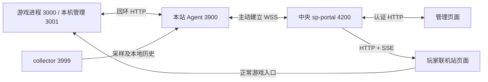

# DESIGN §34, §35, §36, §37, §38, §39, §40, §41, §42, §43, §44, §45, §46, §47, §48, §49, §50, §51, §52, §53 — 游戏站 Agent 与 sp-portal 双向通信实施方案

Part of [DESIGN.md](../DESIGN.md) (the index; section numbers are global).

日期：2026-10-14。状态：待实施设计，不代表当前代码已经支持。

核对基线：游戏仓库 `cee3bb00`；sp-portal 仓库 `9863b70`。实施前检查两边 HEAD 和工作区变化。本方案只新增设计文档，不修改业务代码、不操作线上服务。

## 34. 确定的架构决策

1. 每台游戏站的 Agent 主动连接中央 sp-portal 的 WSS 服务；一个站点保持一条经过认证的活动连接。
2. collector 保留本机采集职责。游戏保留对局、房主鉴权、运行配置校验及落盘职责。Agent 承接跨机通信。
3. 游戏与 Agent 双向调用仅使用固定回环 HTTP 接口及独立凭据，不让游戏进程承担中央长连接维护。
4. 玩家页面继续 HTTP + SSE；管理页面继续认证 HTTP API。WSS 是服务器之间的通道。
5. WSS 站点与旧 HTTP 站点显式配置，不能因 WSS 暂时掉线就自动改走旧管理链路。
6. 公告属于可重试的版本化状态；配置修改和关闭房间属于有截止时间的操作。两者不共用离线自动重放规则。
7. 房间登记只接受主动分享，保留十分钟有效期、每站二十条上限，不枚举所有游戏房间到公开大厅。
8. 首版中央服务保持单实例。跨实例连接路由、共享限流和主节点选举不纳入首版。



这次改造解决跨机链路分散和反向访问依赖，不保证公网游戏入口一定可达，也不把联机站变成游戏流量中转站。

## 35. 当前实现与必须保留的行为

| 功能 | 当前实现 | 改造要求 |
| --- | --- | --- |
| 监控 | collector 默认 15 秒采样；Agent 默认 10 秒读取；中央面板默认 10 秒拉 Agent | 保留采样口径和脱敏投影，中央改为接收上报 |
| 玩家页健康 | 中央默认 15 秒访问游戏 `/healthz` | WSS 站点使用 Agent 本机健康快照，另保留低频公网探测 |
| 历史 | 本地 JSONL、带游标补传、中央 SQLite worker | 保留 sampleId 去重、原采样时间、事务提交游标、gap 语义 |
| 公告 | 中央按站保存 revision；HTTP 写 Agent；Agent 原子写文件 | 复用校验、旧版本拒绝、同版本同内容幂等、撤下版本 |
| 游戏配置 | 五个字段，经 Agent 调游戏回环 API，保存 `.state/room-admin.json` | 保留字段白名单，新增配置版本与操作关联 |
| 关房 | 管理页 → Agent → 游戏，校验 createdAt | 增加 roomId，保留兼容检查；过期命令不补执行 |
| 游戏分享 | 游戏 HMAC POST 中央；中央公网回查游戏状态 | 改为游戏 → 本机 Agent → WSS，并从本机核验 |
| 手工登记 | 联机站登记、所有权 cookie、续期、删除、随机加入 | 保留这些入口及其权限，通过统一传输适配器核验 |
| 浏览器实时 | SSE 通知重取，15 秒轮询兜底 | 保留 |

相关现有文件：

- 游戏：`server/http/portalRoom.js`、`server/roomAdmin.js`、`server/roomConfig.js`、`server/lobby.js`、`server/persist.js`、`server/announcement.js`、`public/js/screens/room.js`。
- 中央及探针：`server.mjs`、`agent.mjs`、`collector.mjs`、`lib/panel.mjs`、`lib/rooms.mjs`、`lib/room-store.mjs`、`lib/room-probes.mjs`、`lib/history-store.mjs`、`lib/sample-history.mjs`、`lib/agent-announcement.mjs`。
- 分发：`deploy/probe-files.mjs`、`deploy/sync-agent.mjs`、`tools/pack-agent.mjs`。`ops/` 是生成产物，不能手改。

注意两处现状：

- `RoomRegistry.persist()` 当前捕获写盘失败后继续运行，无法支持“中央持久化成功才算分享成功”的新承诺，必须调整。
- `portalSubmitted` 当前是页面布尔值，六十秒后重置，与中央实际十分钟登记期不同；新界面应读取真实登记状态及 expiresAt。

## 36. 服务边界与权威数据

| 数据 | 权威方 | 持久化位置 | 恢复方式 |
| --- | --- | --- | --- |
| 站点名称、入口容量、跳转策略 | 中央 | 现有站点配置 | 中央加载 |
| 期望发布的游戏公告 | 中央 | 现有 PANEL_ANNOUNCE_FILE | 按 revision 重推最新版本 |
| Agent 已写公告 | Agent | 现有公告文件 `_delivery.revision` | 重新读取并上报 |
| 游戏实际读到的公告 | 游戏 | 由公告读取器观察 | Agent 定期回环读取 |
| 游戏运行配置 | 游戏 | 配置文件 v2 | 回环读取实际 revision/values |
| 配置操作意图及回执 | 中央 | 新控制库 | 查询实际结果，不盲目重放 |
| 房间是否存在、人数、是否可加入 | 游戏 | 现有游戏状态 | 本机查询 |
| 哪些房间已登记、expiresAt、所有权 | 中央 | 房间存储 v2 | 启动后读回并重新核验 |
| 监控历史 | collector 原始记录、中央归档 | 现有 JSONL / SQLite | 中央游标驱动补传 |
| WSS 连接与 pending RPC | 两端内存 | 不持久化 | 重连后重新建立 |

中央不以监控快照覆盖游戏配置；游戏不以旧缓存覆盖中央登记有效期。连接状态、业务状态和存储状态分开记录。

## 37. 技术选型与分发

首版推荐：中央使用 `ws` 服务端；Agent 使用 Node 内置 `WebSocket` 客户端；JSON 文本消息；不启用 permessage-deflate；不引入 Socket.IO、Redis 或额外消息队列。

Node 的内置 WebSocket 在 22.4.0 起稳定，现有 sp-portal 要求 Node >=22.13，满足客户端基线。但它提供的是客户端 API，中央仍需要服务端实现。出处：[Node WebSocket](https://nodejs.org/api/globals.html#class-websocket)、[ws 官方仓库](https://github.com/websockets/ws)。

中央增加 `ws` 运行依赖和锁文件；部署中央时执行锁定依赖安装。不要从游戏仓库的 node_modules 隐式加载它。版本实施时锁定并验证，不把本方案里的仓库现有版本当成最新推荐版本。

Agent 继续保持解压即运行、不需 npm install。内置客户端通过第一条认证消息发送凭据，避免依赖自定义握手头。对内置客户端的实际 Node 版本做一次端到端验证，包括应用心跳、bufferedAmount 和关闭行为。

若确实需改用 `ws` 客户端，必须把依赖及许可证纳入探针确定性分发和 VERSION 哈希，不能只改 import 后仍分发旧的无依赖 zip。

## 38. 站点配置、凭据与连接身份

### 38.1 站点模式

新增站点私有连接配置，下面是目标结构示例，不是现有可用配置：

```json
{
  "id": "hongkong",
  "name": "香港站",
  "playUrl": "https://game.example.com/",
  "apiUrl": "https://game.example.com/",
  "roomApi": true,
  "integration": {
    "mode": "agent-wss",
    "agentKeyId": "hk-202610-a"
  }
}
```

`mode` 为 `legacy-http` 或 `agent-wss`；旧配置省略时默认 legacy-http。WSS 站点不要求 adminUrl/tokenEnv；旧站点继续现有校验。旧字段可暂存供显式回滚，但 WSS 模式不使用它们执行管理写入。

不能继续只用 `sites.filter(s => s.adminUrl)` 定义可管理站点。新增站点筛选规则，覆盖 WSS 与 legacy 两种模式。公开 entries 投影不包含 keyId、权限、令牌或私有地址。

### 38.2 凭据分离

| 凭据 | 使用方 | 权限 |
| --- | --- | --- |
| 新 Agent 中央连接凭据 | Agent → 中央 | 绑定一个 siteId 和一组 scope |
| 现有游戏管理 Token | Agent → 游戏 3001 | 本机查询及白名单管理 |
| 新游戏桥接 Token | 游戏 → Agent 3900 | 仅分享、撤下、登记状态查询 |
| 面板 Basic Auth / 管理密钥 | 管理者 → 中央 | 现有管理权限 |
| 原 RO/RW、房间 HMAC key | legacy 链路 | 迁移期按旧用途保留 |

连接 Token 每站独立，使用 32 个随机字节生成的 hex。中央独立私有凭据文件保存 `keyId → {siteId, tokenHash, scopes, enabled}`，只存 SHA-256 摘要；比较摘要用 timingSafeEqual。新文件不复用现有需要向远端发送明文的 probe.secrets.json 结构。

建议 scope：`metrics.publish`、`history.publish`、`announcement.apply`、`config.read`、`config.write`、`rooms.read`、`rooms.close`、`rooms.publish`。实际能力为“中央授权 scope ∩ Agent 声明能力 ∩ 游戏支持能力”。Agent 不能仅靠自报 capability 获得权限。

Token 不放 URL、站点 JSON、网页、日志和错误正文。拒绝浏览器 Origin 的中央 WSS 握手；不通过 CORS 建立可信关系。远端只能调用固定 action，不能传任意 URL、路径、命令、文件名或服务名。

### 38.3 连接身份

- `agentInstanceId`：Agent 首次运行生成 UUID，持久保存在独立状态目录；重启不变。
- `agentBootId`：每次 Agent 进程启动生成 UUID。
- `connectionId`：中央每次认证成功生成 UUID，只对本连接有效。
- `serverBootId`：中央每次启动生成 UUID，用于识别中央重启和失效 RPC。
- `gameBootId`：游戏每次启动生成 UUID，供本机接口报告；用于发现游戏已重启。

同站同 agentInstanceId 的新认证连接可取代旧连接；中央先使旧连接失效，再激活新连接。异步回调写入前检查 connectionId 仍然活动，防止旧 close 回调清掉新连接或旧结果覆盖新快照。

同站不同 agentInstanceId 默认拒绝并告警，避免误装两个 Agent 来回抢占。更换机器由管理员显式重置绑定或轮换凭据。同一台机器依靠 systemd 单实例运行，实例状态目录不得被两台机器克隆共用。

撤销凭据或删除站点时立即关闭现有连接、拒绝后续消息、取消未发送操作。已经进入游戏执行的操作可能无法取消，必须记录为待确认并查询实际结果。

## 39. WSS 协议 v1

### 39.1 建连与认证

中央端点：`/api/agent/v1/connect`；WebSocket 子协议：`sp-agent.v1`。

顺序：HTTP Upgrade → 五秒内首帧认证 → 中央返回 welcome → 初始同步 → ready。ready 之前只允许认证、心跳和同步消息，不执行管理写入。

```json
{
  "v": 1,
  "type": "auth",
  "siteId": "hongkong",
  "keyId": "hk-202610-a",
  "token": "<仅通过 WSS 首帧发送，不记录>",
  "agentInstanceId": "<uuid>",
  "agentBootId": "<uuid>",
  "opsVersion": "sp-ops-xxxxxxxxxxxx",
  "capabilities": ["metrics.publish", "history.publish", "announcement.apply", "rooms.read"]
}
```

中央只按凭据注册表决定身份，校验声明 siteId 相符。未知站点不能自动注册。认证期间限制消息大小、连接总数及超时，不缓存首帧原文。凭据不正确统一返回 AUTH_FAILED，不泄漏 keyId 是否存在。

```json
{
  "v": 1,
  "type": "welcome",
  "connectionId": "<uuid>",
  "serverBootId": "<uuid>",
  "serverTime": 1791936000000,
  "heartbeatMs": 20000,
  "scopes": ["metrics.publish", "history.publish", "announcement.apply", "rooms.read"],
  "limits": {"maxMessageBytes": 262144, "maxPendingRequests": 16}
}
```

后续消息不重复携带 Token，也不接受消息自带 siteId 来切换身份。站点身份从认证连接对象取得。

### 39.2 通用请求和回执

```json
{
  "v": 1,
  "type": "request",
  "id": "<本连接请求 uuid>",
  "action": "config.patch",
  "opId": "<持久业务操作 uuid>",
  "expiresAt": 1791936030000,
  "payload": {
    "expectedRevision": 17,
    "patch": {"allowBots": false}
  }
}
```

```json
{
  "v": 1,
  "type": "response",
  "replyTo": "<本连接请求 uuid>",
  "ok": true,
  "payload": {
    "opId": "<持久业务操作 uuid>",
    "revision": 18,
    "persisted": true,
    "applied": true,
    "values": {"maxRooms": 1000, "allowBots": false}
  }
}
```

示例 values 为节选，实际 config.get/config.patch 返回全部五个支持字段及只读能力信息。

失败统一返回 `ok:false,error:{code,retryable}`；按需附白名单详情，例如 currentRevision。不要透传 stack、本机路径、上游响应原文。`retryable` 只供界面解释，是否重试还由 action 的固定策略决定。

`id` 用于连接内相关性；`opId` 用于跨连接的业务幂等。一个操作换连接重查时可换 id，但 opId 不变。业务操作同时校验规范化 payload 指纹，同 opId 不同内容返回 OP_ID_CONFLICT。

响应只能结束本连接、相同 action 的 pending 请求，未知 replyTo 丢弃并计数。收到响应不能反过来执行 action。未知 action 返回 ACTION_UNSUPPORTED；非法 envelope 关闭连接。

各 action 明确字段白名单、UUID/整数/数组长度校验，拒绝未知写字段、危险对象键和非安全整数。payloadHash 基于规范化业务字段：固定字段顺序、patch 键排序、布尔值保持类型，不能直接依赖调用者 JSON 属性顺序。deadline 不参与业务指纹，但原操作的有效期不能由重试延长。管理读取响应也要投影，不能透传整个本机对象。

### 39.3 消息目录

| action/type | 方向 | 内容和重试规则 |
| --- | --- | --- |
| `ping` / `pong` | 双向 | 应用心跳，关联随机 nonce |
| `sync.report` | Agent → 中央 | 游戏 boot、配置版本、公告观察、支持能力 |
| `sync.ready` | 中央 → Agent | 初始同步结束；必要能力失败则报告分区降级 |
| `metrics.snapshot` | Agent → 中央 | 最新脱敏快照；带 agentBootId、seq、sampleAt |
| `history.read` | 中央 → Agent | 中央游标驱动读取本地历史页 |
| `history.read` response | Agent → 中央 | records、nextCursor、hasMore、gap |
| `announcement.apply` | 中央 → Agent | 复用 revision、announcement；可重试最新状态 |
| `config.get` | 中央 → Agent → 游戏 | 当前配置、revision、lastMutation |
| `config.patch` | 中央 → Agent → 游戏 | CAS 部分更新；不做断线自动执行 |
| `rooms.list` | 中央 → Agent → 游戏 | 管理页按需分页读取，含私有明细 |
| `rooms.status` | 中央 → Agent → 游戏 | 单房间新鲜投影；支持 expectedRoomId |
| `rooms.close` | 中央 → Agent → 游戏 | opId、roomId、createdAt、deadline；不重放 |
| `room.publish` | Agent → 中央 | 分享申请，中央本机回查后登记 |
| `room.publication.get` | Agent → 中央 | 按 opId 或 roomId 查询登记结果 |
| `room.unpublish` | Agent → 中央 | 经游戏房主鉴权后撤下本实例登记 |
| `rooms.watch.set` | 中央 → Agent | 替换本站登记房间监视集合 |
| `rooms.snapshot` | Agent → 中央 | 当前 watchVersion 对应的完整观测 |

优先用完整消息，首版不实现通用增量事件日志。每站至多二十条登记，完整观测更容易恢复，且可以删除旧状态的歧义。

### 39.4 时间和心跳

应用 ping/pong 每二十秒一次，不依赖 Node 客户端能否调用底层 ping API。无有效 pong 连续六十秒判断开；记录 RTT。必须校验 nonce，普通上报不能代替 pong。

握手五秒，初始同步目标十秒。传输重连使用 full jitter，退避上界按 1/2/4/8/16/30 秒增长，稳定运行六十秒后复位。鉴权错误最多每五分钟重试一次，凭据 reload 可立即触发；不支持协议进入 blocked，避免高速反复连。

从 welcome 计算中央时钟偏移，用 RTT 中点估计，仅服务于通信截止时间。绝对偏差超过三十秒时标记 CLOCK_SKEW，阻止管理写入和新分享，继续监控并告警。超时计时用 monotonic clock，NTP 回拨不能延长命令。

默认期限：回环五秒；WSS 读请求八秒；管理写十秒且总截止不超过三十秒；游戏分享全链路八秒，浏览器十秒。剩余预算逐层传递，内层超时必须小于外层；重查属于新读取，不悄悄续长写操作寿命。

## 40. 队列、背压及资源预算

下面是首版建议默认值，必须配置集中、测试边界，压测后再调整，不是已验证性能结论。

| 项目 | 建议值 |
| --- | --- |
| 未认证连接总上限 / 首帧上限 | 32 / 4 KiB |
| 全局 WSS 总连接上限 | 64，覆盖现有至多十二站及短暂换连 |
| 普通消息上限 | 256 KiB，认证后仍按 action 使用更小限额 |
| 公告 / 配置请求体 | 16 KiB / 2 KiB |
| 历史页 | 最多 20 个样本且编码后不超过 256 KiB |
| 历史流量 | 每站最多一个在途页，初始限速 128 KiB/s |
| RPC 在途 | 每站十六个，其中管理写最多一个 |
| 待发管理请求队列 | 每站十六个，满则返回 BUSY |
| 单站总发送缓冲 | 1 MiB；超过先停止历史，持续十秒则断开恢复 |
| 监控上报 | 新样本到达时推送，最长十五秒报告一次状态 |
| 房间监视 | 有登记时每两秒本机检查，变更推送，十秒完整观测 |
| 房间快照新鲜度 | 十五秒；断链立即禁止随机分配，旧内容可显示为未知 |
| 管理列表 | 默认五十条，最大二百条；超过消息预算提示缩小分页 |

调度优先级：认证/心跳/管理回执 → 新管理请求及分享 → 房间状态 → 监控 → 历史。已经送进 socket 的大帧不能被抢占，所以历史页必须小且一次一个。

监控只保留待发最新一份；房间观测只保留最新完整版本。管理命令不能被静默丢弃或合并；超过队列上限就拒绝。消息队列不能靠 Promise 无上限堆积。

如果单个历史样本编码后超过预算，返回 RECORD_TOO_LARGE 并暂停该页，告警并排查；首版不能静默跳过后推进游标。确需支持大记录时再增加有总大小、块数和超时限制的分块协议。

中央 maxPayload 可限制不可信客户端帧大小；Agent 内置客户端还要在解析前检查消息长度。因为内置客户端没有相同的接收 maxPayload 选项，Agent 只连接已配置且验证 TLS 的中央，中央发送端也要强制限制大小。

## 41. 监控与历史同步

### 41.1 实时快照

Agent 复用现有 refresh/snapshot 逻辑，中央入口再次执行 sanitizeSnapshot，不能因连接已认证就信任所有字段。身份、权限和业务校验仍在中央执行。

快照携带 `agentBootId,seq,generatedAt,sampleAt,sampleId`。seq 每次 Agent 启动从一递增，在同一 boot 下丢弃重复和倒退快照；换 boot 后重新同步。样本沿用 collector 的原始时间及 sampleId，中央接收时间单独保存为 receivedAt。

中央保留最新快照，在现有 publicEntry/overview 投影中使用；告警仍通过 AlertEngine。不能继续依赖 refreshSite 的 HTTP 轮询才能调用告警和归档，需提取统一的 acceptSnapshot/observeAvailability。

WSS 站点停止高频跨机 `/overview`、`/healthz` 拉取。另每六十秒从中央访问一次公网 `/healthz`，记录 `publicReachability`，仅判断中央视角能否访问入口，不冒充玩家地区测速，也不覆盖本机 sample。旧 HTTP 站点继续现有轮询。

首版保留 collector 本机 15 秒、Agent 本机 10 秒节奏即可；WSS 并不会自动消除本机缓存的十秒延迟。后续如需降低采样延迟，再做 collector 新样本通知或独立轻量健康读取。

### 41.2 历史补传

保留中央主动请求的游标模型，只把 HTTP 页请求搬进 WSS：

1. 中央从现有 history SQLite 读取本站已提交 cursor。
2. 发送 `history.read {cursor,limit:20,maxBytes:262144}`。
3. Agent 通过本机 collector 样本接口读取，按编码字节预算缩小页，并返回 records/nextCursor/hasMore/gap。
4. 中央校验数据、再次脱敏，调用现有 worker 的 ingest。
5. 同一 SQLite 事务写 samples、daily 和 cursor，成功后才请求下一页。

history.read 的成功响应只表示“读取到了这一页”，并不表示中央已入库。中央落盘后才推进自己的游标；Agent 不因发送成功删除本地文件。本地保留策略仍由 MON_RETAIN_DAYS 控制。

失去响应就从原游标重读；中央已提交但连接中断，则新连接直接读取中央最新游标。沿用 `(site,sample_key)` 去重，不按 WSS 请求编号去重历史样本。

必须修改本地历史读取器，使 nextCursor 精确对应实际返回的最后一个完整记录，不能先读取二百条后只截取二十条却返回二百条后的游标。坏尾行、文件轮转、inode 变化、超保留期等仍沿用已有 gap 契约。

history 数据库不可写时，当前监控仍能展示，但 archive 状态必须为 error，补传停止，不能伪造游标前进。历史未启用时不请求补传，明确显示 disabled。WSS 接入不能依赖管理页面是否启用，面板认证只控制页面/API 访问。

## 42. 公告：保留版本化最终收敛

### 42.1 发布及恢复

1. 管理者经现有 API 提交。
2. 中央校验并持久化本站公告及 revision，包括 disabled/删除的撤下版本。
3. 中央通过 `announcement.apply` 向活动 Agent 下发最新版本。
4. Agent 调现有 announcementWriter，成功后回 `{revision,persisted:true,unchanged}`。
5. Agent 下一次本机读取游戏 `/api/announcement`，报告游戏已观察到的 revision/source。

断线、中央重启、Agent 重启后，对照实际 writtenRevision，再重发中央最新版本。只需要最新状态，不用逐条回放过时公告。新版本覆盖正在重试的旧版本，但已在途旧请求仍须依靠 Agent revision 检查防止倒退。

同 revision 同内容成功幂等；同 revision 不同内容冲突；低 revision 拒绝。冲突不能靠自动生成更大版本强压，先检查是否两个中央或回滚存储造成。

### 42.2 三层回执

中央状态建议为：`saved / pending / written / observed / blocked`。

- saved：中央已落盘。
- written：Agent 指定文件已落盘。
- observed：游戏读取器已经读到该 revision。这个状态仍不代表所有玩家浏览器都已显示。
- blocked：来源不是 agent、游戏不支持、权限缺失、版本冲突等需处理问题。

游戏 `/api/announcement` 的 source 投影增加可选 `revision`，从读取器实际解析的 `_delivery` 元数据取得，不能从 Agent 期望值推算。保持原 announcement.id 和 displayMode 计算不变，避免重复弹窗。

公告文件版本和正文须一次性读取，避免两次读文件之间切版本。过期/撤下时也保留实际 observedRevision，用来区分“已读到关闭指令”和“读失败”。Agent 上报的是游戏返回值。

文件权限、目录原子替换、Docker 整个目录只读挂载、到期判断和浏览器缓存规则保持。中央入口页 notices 与游戏公告是独立系统，不合并存储。

## 43. 游戏配置：版本检查、落盘和结果确认

### 43.1 首版字段范围

继续只开放 `maxRooms`、`allowBots`、`limitForeignSessions`、`allowForeignConnections`、`maxForeignSessionsPerIp`。其他启动变量不因 WSS 可用就自动纳入；新增字段必须独立定义验证、实时应用和重启恢复行为。

入口页 capacity/entryPolicy 仍属中央配置，不能与游戏 maxRooms 混成一个“容量”。不提供任意 env 编辑、远程 shell、文件改写或重启服务动作。

### 43.2 游戏配置文件 v2

```json
{
  "schemaVersion": 2,
  "revision": 18,
  "values": {
    "maxRooms": 1000,
    "allowBots": false,
    "limitForeignSessions": true,
    "allowForeignConnections": true,
    "maxForeignSessionsPerIp": 1
  },
  "lastMutation": {
    "opId": "<uuid>",
    "payloadHash": "<sha256>",
    "revision": 18
  }
}
```

现有 v1 读取后转换为 values，首次迁移写入 v2 时从 revision=1 开始。新读取接口返回 revision、全部 values、只读能力、lastMutation；旧调用方的顶层字段可兼容返回一段过渡期。

执行 config.patch：进入游戏已有串行 limitWrites 队列 → 再检查 deadline → 检查最近 opId/指纹 → 比较 expectedRevision → 校验 patch → 合并当前 values → 写入 revision+1 和 lastMutation → applyRoomConfig → 返回实际值。

必须在队列内部做 CAS，不能在入队前检查。旧 HTTP PUT 如在迁移期保留，也要走同一串行入口并递增 revision；不能绕开版本控制改文件。

同 opId/指纹命中 lastMutation 时，不再递增 revision，返回当前实际状态和 originalResultRevision；同 opId 不同内容拒绝。更老的操作如果不在 lastMutation 中，旧 expectedRevision 使它冲突，不能重新套用。

持久化成功才更新内存配置。applyRoomConfig 应同步完成受支持字段的应用；若发生异常，报告 persisted=true/applied=false 并降级，重读恢复或重启加载，不能报全部失败后让操作者误认为磁盘也没改。完整的运行副作用如容量回收仍按游戏原有语义执行。

原子写至少覆盖临时文件 fsync、rename；Linux 生产上同步目录以加强断电保证。普通原子 rename 只解决替换可见性，不能单凭它宣称断电永不丢失。

### 43.3 中央操作记录与离线策略

新增独立 `PORTAL_CONTROL_FILE=/var/lib/sp-portal/control.sqlite`，由独立 worker 管理，不与可选历史归档的开关绑定。用途是操作状态和管理审计，不复制完整监控历史。

建议表：`operations(op_id PK,site,action,actor,payload_hash,expected_revision,created_at,expires_at,status,result_json,updated_at)`。仅白名单必要字段；不保存 Token、玩家 IP、私有房间列表或任意请求原文。通过现有认证得到 actor。

状态：`prepared → sent → succeeded/failed/unknown`；sent 先落盘再发。若标记 sent 后崩溃但实际没发，同样按 unknown 处理，避免误报。中央重启时 prepared/sent 先转为待确认，不自动重发。

首版配置写仅在线 ready 时接受；离线直接 AGENT_OFFLINE。在线接受后先保存操作记录，再发送，响应成功才记 succeeded。允许管理页提交前读取 fresh revision，过时页面获得 CONFIG_CONFLICT 并展示实际值。

回执丢失时：读取 config.get；lastMutation.opId/指纹匹配可确认成功。只因 values 恰好相同不能认定某操作执行过。如果有后续写入导致无法证明，显示 unknown 和当前值，由管理员决定是否基于新 revision 再提交。

不要在首版实现“中央期望配置每次重连强制覆盖游戏”。离线排队配置如未来需要，应作为独立功能，定义有效期、取消、冲突、审批和游戏现场修改的优先级。

## 44. 房间管理与关房

管理列表继续打开页面才查询，保留分页。WSS 缓存只用来展示概览，不把完整私有 rooms.list 永久推送、归档或广播给玩家。浏览器离开页面可以取消等待，但已经发出的写命令不能保证撤回。

游戏 Room 新增 `roomId=randomUUID()`，创建时生成，加入 roomDoc，恢复时校验并保留。旧存档没有 roomId 时生成一次并尽快持久化；不能把这次变化当成开新对局。createdAt 保留用于展示和旧接口兼容。

rooms.close 带 `opId,code,expectedRoomId,createdAt,expiresAt`。游戏在真正 disposeRoom 前检查 deadline、房间实例和权限。roomId 不匹配返回 ROOM_CHANGED，绝不按同码的新房间执行。

首版关房不自动重试。超时或断线后记 unknown，重新查询 expectedRoomId：

- 实例仍存在：显示“未确认关闭，可重新操作”，再次点击产生新 opId。
- 实例已不存在：显示“目标房间已不存在”，不能因此证明一定是该命令关闭。
- 同码新实例：展示房间已变更，必须重新选择目标。

若以后要保证关房命令跨崩溃精确归因，需要游戏侧持久化操作日志并定义与房间状态落盘的事务关系；单靠 WSS requestId 或内存去重不能实现 exactly-once。

## 45. 房间分享、登记与同步

### 45.1 游戏到 Agent 的本机入口

Agent 新增 `/internal/game/v1/publications` 的 POST、状态查询及撤下入口，使用独立桥接 Token。只绑定回环、禁止 Origin、限请求体与在途数；游戏目标地址在启动配置里固定，浏览器不能指定目的地。

游戏现有 `/api/portal-room` 保留 GET/POST。POST 继续检查在线会话、当前房主、协力待机空位、未排队、同源和限流，检查完成后绑定当前 roomId，再转给 Agent。Agent 可通过新增游戏私有单房间接口再核验实例及 joinable。

游戏为当前实例的分享申请生成 opId，失败后保留该 opId 用于查询，不能每次超时都生成新申请。请求包含 code/roomId/opId/短截止时间，不包含玩家 session Token。游戏在返回浏览器前重新确认请求对应的 roomId，晚回执不修改新房间界面。

分享 POST 只有 registered=true 才返回明确收录成功；已发送但回执未知可返回 202 和 pending 状态。前端不能继续用 response.ok 判断已经收录，必须检查业务状态，202 进入查询流程。浏览器断开后中央可能仍完成登记，不能把取消 fetch 当作撤销发布。

新增认证的游戏登记状态查询入口，例如 `GET /api/portal-room/status?code=ABCD`。仅当前房主可查本站当前实例；公开 GET `/api/portal-room` 仍仅报告功能 enabled/available。操作结果待确认时界面调用状态查询。

### 45.2 登记确认顺序

1. Agent 将绑定实例的 `room.publish` 发中央。
2. 中央按连接身份获取站点，检查 mode、scope、TTL、每站上限及在途登记。
3. 中央通过同一 WSS 的 rooms.status 请求 Agent，本机检查 expectedRoomId，复用公开投影规则；这是嵌套 RPC，消息调度不能等待前一个请求结束才处理回查，否则会死锁。
4. 房间为可加入协力待机状态时，中央生成 listingId，登记十分钟，持久化条目与 opId 结果。
5. 中央成功回 `{listingId,roomId,expiresAt,registered:true}`，游戏才显示已收录。

两次检查之间房间仍可能满员或开局，跨机无法锁住游戏状态。之后观测及时更新、随机加入即时核验，最后游戏加入动作再做权威检查。不要承诺“收录成功后一定有空位”。

### 45.3 房间存储 v2 与可靠回执

首版保留现有小规模 JSON 房间存储，不额外迁移全部房间到数据库；但改成异步串行、先持久化再发布内存结果：

```json
{
  "version": 2,
  "rooms": [
    {
      "listingId": "<uuid>",
      "siteId": "hongkong",
      "code": "ABCD",
      "roomId": "<游戏房间 uuid>",
      "source": "game",
      "addedAt": 1791936000000,
      "expiresAt": 1791936600000
    }
  ],
  "publicationResults": [
    {
      "opId": "<uuid>",
      "siteId": "hongkong",
      "roomId": "<uuid>",
      "payloadHash": "<sha256>",
      "listingId": "<uuid>",
      "expiresAt": 1791936600000,
      "retainUntil": 1791938400000
    }
  ]
}
```

示例 room 为节选，实际保留现有 server/note/url/token/snapshot 等内部字段。token 仍仅服务手工登记所有权，不能进入 WSS 分享回执或公开数据。

新 `commitMutation` 在单个串行队列内：清理过期 → 从当前已提交结构复制 → 应用业务变更 → 检查容量/体积 → 原子写完整新文档 → 发布内存状态 → 广播 SSE → 回成功。失败保留旧内存、抛出 STORAGE_WRITE_FAILED；不再吞错。

登记及其幂等结果在同一文件替换中提交，避免“房间写了但 opId 没写”。续期、移除、自动确认关闭、站点变更和过期清理也要进入同一变更入口，不能和异步登记交错丢更新。状态观测可在内存更新并低频保存，但不能绕过串行提交覆盖登记集合。

publicationResults 保留四十分钟，最多四千零九十六条；文件读写统一上限 8 MiB，写前清理已到期结果，满时拒绝新登记。该预算应由实际编码测试验证。异步文件 IO，不能每两秒用同步大 JSON 写阻塞中央主线程。

同 opId/相同实例重复申请返回原结果，不延长 expiresAt；条目已删除或过期，返回原申请已结束，不重新建立。结果记录清理后，原短截止时间仍使旧申请失效。新点击重发必须生成新 opId。

同实例已有手工登记时，游戏分享返回其现有 expiresAt，不覆盖所有权 token；不能通过游戏分享拿到原手工登记的管理权。同码不同实例不得继承旧条目或旧所有权，应在核验后结束旧登记、按新申请创建。

rename 后的目录同步若失败，持久化结果可能不确定，返回 STORAGE_UNCERTAIN 并阻止后续写入直至重读/恢复；不能在内存回滚后无视磁盘可能已经变更。区分普通进程崩溃一致性与断电持久性。

### 45.4 watch 与完整观测

中央按当前持久登记集合发送 `rooms.watch.set {watchVersion,items:[{listingId,code,roomId,expiresAt}]}`。Agent 只监视这些房间；服务重连后重新发送完整集合。

首版采用本机每两秒查询，变更时合并推送，最长十秒发完整观测。可以增加游戏私有批量查询端点，每次最多二十个目标，只投影人数、模式、难度、joinable、阶段及实例，不返回全量私有列表。无需第一版改所有 lobby 生命周期事件。

观测携带 gameBootId、agentBootId、seq、watchVersion；每个条目带 listingId/roomId 和 `ok / closed / unknown`。只接受活动连接、当前 watchVersion 及递增 seq。

必须区分“查询确认不存在”和“游戏请求失败”。请求失败返回 unknown，不能用空数组冒充所有房间关闭。完整观测遗漏目标时也先 unknown，不能删除未经确认的条目。

房满/开局更新为 full/playing；房间销毁或同码已变实例时移除对应旧 listingId；到期由中央时间裁定，状态更新不续期。断链立即停止随机分配本站房间，恢复并得到新观测后再开放。

首版不增加增量 seq 补传。漏事件、Agent/中央重启均靠“中央登记集合 + 本机当前状态”重建。游戏重启后房间 UUID 保持，但旧观测全部过期，不能只因为 roomId 相同就当成新鲜。

### 45.5 手工登记、续期与随机加入

手工登记与游戏分享共用 Registry 入库和状态投影，不另建第二个大厅。WSS 站点的手工登记核验通过 rooms.status；旧 HTTP 站点继续公开状态接口。

对 WSS 手工登记，首次核验时取得 roomId 并保存；续期、删除、随机加入始终绑定该实例。旧条目无 roomId，先 fresh 查询补齐，再允许操作；已确认实例变化时旧所有权不能转移。

随机加入保留原有候选数、总截止、站点公平性和有界探测队列。把队列实际 run 指向统一 transport.roomsStatus，别让 WSS 绕过并发预算。掉线站点快速失败，不等历史补传、不偷偷改走公网核验。

游戏侧撤下仅由当前房主授权，只作用于 source=game 的当前实例登记。手工登记仍按原所有权规则删除。撤下重复请求幂等；撤下后历史申请回执不能重新激活房间。

浏览器反馈：未配置则隐藏分享；配置了但中央不可用则显示暂不可用；提交中禁重复；结果待确认提供查询；成功显示中央 expiresAt 对应剩余时间。六十秒冷却与十分钟有效期分开，不能继续用同一个布尔计时器表示。

给现有大厅房间视图增加可选 roomId，前端按 roomId 和 hostId 变化清理旧登记状态及在途结果；UUID 只是实例标识，不是授权凭据。战斗模拟消息无需因此改版。公开功能探测的 available 可通过游戏对 Agent 的短期本机缓存取得，不让每个浏览器探测触发新的中央 RPC。

## 46. 传输适配层与文件改造清单

以下新文件名是建议划分，可以按项目风格调整。关键是业务服务不依赖 req/res/socket，HTTP 与 WSS 只负责鉴权、解码、限流、调用服务和编码结果。

### 46.1 sp-portal

| 文件 | 工作内容 |
| --- | --- |
| 新 `lib/agent-protocol.mjs` | envelope/action 校验、错误码、编码字节限制、共享常量；可下发 Agent |
| 新 `lib/agent-channel.mjs` | 中央 Upgrade、首帧认证、连接注册、取代连接、scope、心跳 |
| 新 `lib/agent-rpc.mjs` | pending、请求截止、请求取消、队列、响应相关性；可下发 Agent |
| 新 `lib/agent-keys.mjs` | 私有摘要凭据存储、签发、撤销、实例绑定及 reload |
| 新 `lib/site-transport.mjs` | `getOverview/getRoomStatus/listRooms/getConfig/patchConfig/closeRoom/applyAnnouncement/readHistory` 统一接口 |
| 新 `lib/control-store.mjs` | 控制 SQLite worker、操作状态、审计和查询 |
| 新 `lib/room-publications.mjs` | room.publish/结果查询/撤下服务，不直接操作 socket |
| `server.mjs` | 安装中央 Upgrade；创建统一 transport；按站模式调度；替换公网回查入口；启动/关闭资源 |
| `lib/panel.mjs` | 从 HTTP refresh 中提取快照接收；管理动作通过 transport；新增 operation 查询 |
| `lib/rooms.mjs` | roomId/listingId；统一核验；异步串行持久化；先提交后更新内存和广播 |
| `lib/room-store.mjs` | v1→v2 迁移、receipt、8 MiB 统一读写限额、异步原子提交 |
| `lib/room-probes.mjs` | 保留有界队列；根据 transport 错误区分离线、忙、未知、实例变化 |
| `lib/history-store.mjs` | 保留 ingest 事务和去重；与 WSS 数据入口衔接；连接可用性观察节奏调整 |
| `lib/metrics.mjs` / `lib/alerts.mjs` | 投影新 connection/game/publicReachability/archive 状态与新告警 |
| `lib/game-room-publish.mjs` | 保留 legacy 签名入口；WSS 站点拒绝旧发布写入，避免双轨 |
| `lib/rooms.mjs` 中 loadSites/serializeSites | integration 配置、两模式校验、公开投影排除私有字段 |
| `client/ops/` | 连接状态、实际配置 revision、操作待确认、公告三级状态、凭据一次性展示 |
| `client/` | 房间 unknown/不可加入语义；保留 SSE 和现有登记入口 |
| `package.json` / lock | 中央 ws 依赖；协议及分发检查命令 |

建议接口边界：

```js
// SiteTransport：身份在调用前绑定，不能由 action payload 指定 URL/token。
transport.forSite(siteId).getRoomStatus({ code, expectedRoomId }, { signal, deadline });
transport.forSite(siteId).patchConfig({ opId, expectedRevision, patch }, { deadline });
transport.forSite(siteId).applyAnnouncement({ revision, announcement });
```

WSSTransport 在无连接时快速抛 AGENT_OFFLINE；LegacyHttpTransport 使用现有固定 URL 和 Token。一个业务流程不能同一 action 先 WSS 再自动 HTTP。声明不支持动作就返回 CAPABILITY_UNSUPPORTED。

房间 Store 改异步会影响 add/renew/remove/update/reconcileSites 和广播包装，必须逐个调整 await、错误和退出 drain，不能只修改 persist 函数后留下调用方不等待。

新增管理查询 `GET /api/panel/v1/operations/:opId`，只允许通过中央管理认证，并校验站点存在。原写 API 完成时仍返回 200；超过同步等待但执行可能已发生时返回 202 和 `{opId,status:"unknown"}`，管理页面查询结果。明确结果未知，不能包装成成功。

### 46.2 Agent 与 collector

| 文件 | 工作内容 |
| --- | --- |
| 新 `lib/agent-client.mjs` | 原生 WebSocket、认证、重连、同步状态机、心跳、发送背压 |
| 新 `lib/agent-actions.mjs` | 本机业务函数；现有 HTTP handler 与 WSS handler 共用 |
| 新 `lib/game-bridge.mjs` | 游戏→Agent 桥接接口、独立 Token、分享/状态/撤下 |
| 新 `lib/room-watch.mjs` | 中央 watchVersion、本机批量检查、完整快照、unknown 判定 |
| `agent.mjs` | 组合以上模块；保留 legacy API；分区报告；独立管理读写能力 |
| `lib/sample-history.mjs` / `collector.mjs` | 增加编码字节预算，返回准确 cursor；不改变采样来源和指标口径 |
| `lib/agent-announcement.mjs` | 复用原 writer；按需要增加持久化保证，避免复制校验逻辑 |
| `deploy/probe-files.mjs` | 加入所有 Agent 新运行文件、共享协议和随包文档 |
| `deploy/install-agent.sh` | 新配置、独立状态目录、保留旧 env、显式迁移、不擅自覆盖密钥 |
| `deploy/sp-admin.service` 和安装器生成 unit | StateDirectory、可写范围、关闭排空和重启规则一致 |
| `tools/pack-agent.mjs` / sync 检查 | 完整生成产物、VERSION 与 zip 一致 |

WSS 能力不能继续用 `!!writer` 代替全部管理权限。公告写入、游戏配置写入和关房能力各自判断本机依赖是否可用。

### 46.3 游戏仓库

| 文件 | 工作内容 |
| --- | --- |
| `server/lobby.js` | Room UUID、恢复、私有批量状态读取所需访问；首版不改战斗消息协议 |
| `server/persist.js` | roomDoc 保存 roomId；旧存档无字段兼容生成 |
| `server/roomAdmin.js` | 私有单房间/批量投影、gameBootId、config CAS、roomId 关房、deadline |
| `server/roomConfig.js` | v1/v2 读取迁移、values/revision/lastMutation、原子持久化 |
| `server/http/portalRoom.js` | legacy-http/agent 两种显式分享模式；本机桥接；opId 与结果查询 |
| `server/http/config.js` / `server/index.js` | 校验模式与本机 URL；配置传入；关闭资源；siteId 别名冲突校验 |
| `server/announcement.js` / `server/http/routes.js` | 读到的公告 revision 投影；保持 announcement.id/展示策略 |
| `public/js/screens/room.js` | enabled/available/提交中/待确认/已登记/到期状态 |
| `public/i18n/` | 新提示文案全部语言和扫描检查 |
| `custom_docs/operations/` / `custom_docs/development/CUSTOM_API.md` | 部署、公告、管理/分享 API 和排错说明 |

游戏本机新增端点建议：

- `GET /api/portal/rooms/:code/status`：Bearer 游戏管理 Token，仅回环；返回 roomId、createdAt、gameBootId 和必要公开状态。
- `POST /api/portal/rooms/status-batch`：最多二十项，返回逐项目标实例的 ok/closed/unknown；不枚举未知房间。
- `GET/PUT /api/room-config`：扩展版本化请求及返回，原五字段校验不变。
- `POST /api/rooms/:code/close`：扩展 expectedRoomId/opId/expiresAt；兼容路径也走统一执行入口。

`roomAdmin.js` 当前只接受 rooms/room-config 前缀，新增 portal 前缀时要一起修改路由白名单；不能让新端点被顶层 404 截掉。

## 47. 配置与部署模板

所有新增变量都需要实现后才生效，以下用于约定名称和部署清单。示例 Token 都是占位符，不能直接使用。

### 47.1 中央 portal.env

```ini
# 现有 origin、trustProxy、面板认证、状态文件配置继续保留
PORTAL_AGENT_ENABLED=1
PORTAL_AGENT_KEYS_FILE=/var/lib/sp-portal/agent-keys.secrets.json
PORTAL_CONTROL_FILE=/var/lib/sp-portal/control.sqlite
PORTAL_AGENT_HEARTBEAT_MS=20000
PORTAL_AGENT_DEAD_MS=60000
```

keys 文件 0600，目录 0700。新控制库备份用 SQLite 一致性备份方法，不直接复制活动数据库而遗漏 WAL。新增凭据及控制库加入 state/history 备份工具、恢复说明和权限校验。

### 47.2 Agent admin.env

```ini
SP_SITE_ID=hongkong
MON_PORTAL_WS_URL=wss://entry.example.com/api/agent/v1/connect
MON_PORTAL_AGENT_KEY_ID=hk-202610-a
MON_PORTAL_AGENT_TOKEN=<本机持有的独立随机凭据>
MON_AGENT_STATE_DIR=/var/lib/stronghold-agent
MON_GAME_BRIDGE_TOKEN=<游戏到Agent的独立桥接凭据>

# 已有本机配置，值需与本站游戏一致
MON_GAME_ADMIN_URL=http://127.0.0.1:3001/
SP_GAME_ADMIN_TOKEN=<对应游戏SP_ROOM_ADMIN_TOKEN>
MON_COLLECTOR_URL=http://127.0.0.1:3999/api/data
MON_ANNOUNCEMENT_URL=http://127.0.0.1:3000/api/announcement
MON_ANNOUNCEMENT_FILE=/var/lib/stronghold-announcement/announcement.json
```

MON_PORTAL_WS_URL 只允许 wss；仅自动化本机测试允许 loopback ws。不能关闭 TLS 验证，不能自动跟随到别的 origin。不要让面板下发新连接目标 URL；该地址属于运维启动配置。

Agent unit 增加 `StateDirectory=stronghold-agent`，由 spmonitor 持有实例状态；保留原公告目录写权限。collector 的数据目录和用户分工不变。现有 Agent 单核 10% CPUQuota、MemoryHigh/Max 先保留，补传有压力先限流，并根据测量调整。

### 47.3 游戏环境

```ini
SP_PORTAL_ROOM_MODE=agent
SP_SITE_ID=hongkong
SP_PORTAL_AGENT_URL=http://127.0.0.1:3900/
SP_PORTAL_BRIDGE_TOKEN=<与Agent MON_GAME_BRIDGE_TOKEN一致>
SP_ROOM_ADMIN_TOKEN=<与Agent SP_GAME_ADMIN_TOKEN一致>
SP_ROOM_ADMIN_PORT=3001
SP_ANNOUNCEMENT_SOURCE=agent
SP_ANNOUNCEMENT_AGENT_FILE=/var/lib/stronghold-announcement/announcement.json
```

分享模式建议 `off / legacy-http / agent`，旧配置根据完整 HMAC 三项默认兼容 legacy-http。agent 模式不要求游戏持有中央连接 Token 或旧房间 HMAC key。

统一 SP_SITE_ID 作为新配置的站点 ID。旧 SP_PORTAL_SITE_ID 可作兼容别名，但两者同时出现且不同就拒绝启动；不要公告用一个 ID、分享用另一个 ID。

本机 URL 校验仅允许 loopback、HTTP、固定根路径，无用户名/密码/query/hash；Token 独立校验。Docker 分离容器时 127.0.0.1 并不互通：首版要求游戏与 Agent 使用同一网络命名空间或同宿主机回环；若要支持容器私网地址，另设计限定网段及鉴权，不直接放开任意 URL。

### 47.4 中央 Nginx

在中央 server 块加入精确匹配路由，独立于现有 `/api/` 二十秒超时：

```nginx
location = /api/agent/v1/connect {
    proxy_pass http://127.0.0.1:4200;
    proxy_http_version 1.1;
    proxy_set_header Upgrade $http_upgrade;
    proxy_set_header Connection "upgrade";
    proxy_set_header Host $http_host;
    proxy_set_header X-Real-IP $remote_addr;
    proxy_set_header Origin $http_origin;
    proxy_read_timeout 90s;
    proxy_send_timeout 90s;
    proxy_buffering off;
    proxy_cache off;
}
```

Upgrade/Connection 需要显式转发，且心跳间隔必须小于代理空闲超时。见 [Nginx 官方 WebSocket 文档](https://nginx.org/en/docs/http/websocket.html)。

同时更新独立中央模板和共享游戏域名使用的 snippets；`nginx -t` 后 reload。该路由不能经过缓存、登录跳转、验证码或 JS challenge。CDN 若不能提供稳定 WSS，应使用独立受 TLS 保护的接入域名。

现有 SSE 路由和代理超时保持。游戏服 3900/3999/3001 均不开放公网。已完成迁移的站点删除/关闭 `/api/admin/v1/` 公网反代入口；不要误删游戏公开房间状态和正常游戏 WebSocket 路由。

## 48. 启动、停机与异常恢复

### 48.1 中央启动

校验 env 和凭据 → 打开控制库及房间存储 → 建 Registry → 建 transport → 安装 Upgrade → 启动 HTTP → 按站模式启动读取循环。不得在存储准备前接收 room.publish 或 config.patch。

存储坏了保留证据，不自动当空表继续写。监控归档故障可分区降级；控制库/房间库故障则对应写能力 blocked，玩家游戏运行不受影响。

### 48.2 Agent 初始同步

认证成功 → 读取本机 gameBootId/配置/公告 → 报 sync.report → 中央更新 capability 和实际值 → 设置房间 watch → 接收首份新观测 → 标记相应分区 ready → 后台开始补历史。

game 不可用时 Agent 仍可 online，但 config/rooms 分区 blocked；不需要为了采集局部失败反复断 WSS。公告 writer 可用与游戏读取可用也分别报告。

### 48.3 停机

中央进入 draining，停止接受新管理写/分享，等待已接受存储提交及有限在途操作，最长十秒，随后标记未确认操作 unknown，再关闭 WSS/HTTP/worker。关闭顺序须防止 writer 已关而回执还回成功。

Agent 停机停止新本机桥接和新动作，发送 draining，等待公告 writer 和有限本机写完成，关闭 WSS 后退出；不由 Agent 自动重启游戏。SIGKILL/断电走恢复路径，不能依赖优雅退出保证。

### 48.4 故障策略

| 情况 | 应有行为 |
| --- | --- |
| 中央不可达 | 游戏照常；collector 继续；分享快速失败或待确认；配置/关房不可提交 |
| Agent 在线、游戏离线 | 显示 game unavailable；不提供房间或配置假成功 |
| Agent 断线 | 连接 offline；登记保留至 TTL 但不可随机分配；公告待下发 |
| 游戏重启 | 发现 gameBootId 改变；旧 room 观测失效；重新读取配置和实例 |
| 中央重启 | 旧 RPC 失效；操作查实际结果；公告重推；房间重新核验；历史按游标接续 |
| Agent 重启 | instance 不变、boot 改变；无离线命令重放；重建 watch |
| 控制库不可写 | 拒绝新管理写，监控与游戏继续；不能先执行再补审计 |
| 房间文件不可写 | 分享/续期/删除拒绝，不能先报成功；过期视图仍按时间禁止加入 |
| 历史库不可写 | 保留实时快照、标 archive error；不推进 cursor |
| 公告写入失败 | 中央保存不丢，按最新 revision 重试；其他站点不受影响 |
| 旧版本/缺能力 | 指明需要升级，禁相应按钮；不伪装为空列表 |
| 同码新房间 | 旧 watch/关房/续期不能作用新实例 |
| 站点删除或凭据撤销 | 关闭连接、持久移除登记、保留必要审计；旧回调无权写入 |

## 49. 管理页面和观测指标

站点详情建议独立显示：连接 online/syncing/offline、最近心跳、RTT、Agent 版本、gameBootId/游戏可用性、sampleAt/样本新鲜度、公网可达性、补传进度/缺口、公告 written/observed revision、配置实际 revision。

每站连接最近错误、下次重连时间、允许能力便于排错；不向公开 entries 泄漏私有信息。概览在线人数仍是游戏 sockets，不是 Agent 数、session 数或房间席位数。

运行指标建议：authenticatedConnections、unauthConnections、reconnectCount、lastPongAgeMs、rpcPending、rpcTimeouts、queueRejected、bufferedBytes、snapshotAgeMs、historyLagSec、historyGap、announcementRevisionLag、configUnknownOps、publicationPersistFailures。计数命名可按现有风格调整。

告警至少覆盖：连接离线、game 离线、样本过期、历史持续落后/缺口、公告未观察、配置结果待确认、凭据/实例冲突、背压反复断开、存储故障。

审计只记录 actor、siteId、action、opId、roomId/listingId、版本、白名单字段变化和结果。认证帧、Token、签名头、完整私有响应禁止日志输出。管理操作审计和完整监控历史属于不同保留策略；首版控制记录建议保存九十天，自动清理已终结操作，未确认记录不得无声清理。

## 50. 分阶段实施与上线顺序

### 阶段 0：建立可回滚基线和存储契约

- 记录两仓提交、部署 env、站点配置及备份；保存原探针 zip/VERSION。
- 先提取 Agent 业务函数和 SiteTransport 的 legacy 实现，验证行为不变。
- 实现游戏 roomId、配置 v2 兼容；实现房间 Store v2 和控制库；准备迁移、校验、导出旧格式工具。
- 修复房间落盘失败仍成功的问题，修改相关 await 和错误反馈。

验收：旧 HTTP 链路仍能监控、发公告、改配置、关房和分享；存储失败不返回成功；旧数据可载入。不要把格式迁移与切换所有线上站点放在同一次不可拆发布。

### 阶段 1：WSS 骨架，先只连通

- 实现协议校验、认证、scope、实例绑定、心跳、重连、资源上限。
- 中央支持两种模式；Agent 可建立连接；增加连接状态页面。
- 测试一个站点连接，暂不授予管理写 scope。

验收：认证/撤销/重复实例符合规则；多次断网重连无资源泄漏；中央关掉不影响游戏；真实 Nginx 下连续连接稳定。

### 阶段 2：监控、历史和只读查询

- WSS 快照进入现有告警、overview 和历史服务。
- 补传、游标、字节预算、背压完整实现。
- config.get、rooms.list/status 走 WSS；legacy 保持。
- 一个试点站切 integration.mode，停止它旧的中央高频读取。

验收：两个通道在测试环境对照相同样本，但生产只选一种权威来源；样本数量和去重正确；旧 HTTP 公网入口不可达时 WSS 仍能只读管理。

### 阶段 3：公告和管理写

- 公告 written/observed 状态与重试。
- 配置 CAS、操作查询、unknown 语义。
- 关房实例与截止检查、结果确认。
- 测试通过后逐项授予试点站写 scope。

验收：两页面同时改配置出现明确冲突；回执丢失不重复执行；过期关房不执行；断线公告重连收敛；落盘失败不会假成功。

### 阶段 4：游戏分享和房间同步

- 游戏→Agent 桥接、房主鉴权、中央登记回执及查询。
- watch 完整观测、UUID、TTL、手工登记兼容、随机加入 fresh 核验。
- UI 用真实登记状态替换布尔计时器；文案国际化。
- 试点站游戏 SP_PORTAL_ROOM_MODE 切 agent；中央拒绝该站 legacy HMAC 发布。

验收：不依赖中央访问游戏公网房间接口即可分享、更新和随机加入；关房/满员/开局状态及时变化；刷新页面不丢登记显示；十分钟不被观测自动续长。

### 阶段 5：逐站迁移及收口

推荐发布顺序：中央新代码及代理 → 游戏兼容代码 → 新探针包 → 凭据/本机配置 → 中央站点模式 → 游戏分享模式 → 观测验收 → 关闭本站公网探针管理反代。

每站分开切换，至少跨一次中央重启、Agent 重启和采样历史追赶窗口。先试点二十四小时，再逐站迁移。全站完成后保留 legacy 代码一个发布周期供显式回滚，第三方 HTTP 站点继续受支持。

### 提交拆分建议

1. 业务函数提取和 legacy transport。
2. 房间/配置持久化兼容与迁移工具。
3. 协议、连接、凭据、RPC 和资源限制。
4. 监控历史接入及只读管理。
5. 公告、配置与关房。
6. 游戏本机桥接、分享和 watch。
7. 页面状态及国际化。
8. 分发、安装、Nginx、备份与运维文档。

每个提交必须能独立解释行为和验证。WSS action 同时修改两端时先发布兼容接收端，再启用发送端。

## 51. 回滚方案

优先做“协议模式回滚”，保留新版本程序和 v2 存储，显式切 legacy-http / legacy 分享模式并恢复旧反代。这样不会因为旧二进制读不懂新存储而丢配置。

确需回滚到改造前程序时：

1. 进入维护状态，停止新的管理写和房间登记，排空或标记在途操作未知。
2. 备份当前 v2 房间、配置、公告、中央控制库及凭据。
3. 用预先测试的导出工具把“当前实际配置”转成 v1；不能直接恢复几天前的备份覆盖新修改。
4. 房间存储导出为旧 rooms 格式，保留有效期及手工所有权；无法兼容的登记显式撤下，通知可重新分享。
5. 停止 WSS 连接和写 scope，切站点模式、恢复旧 Token/HMAC/反代，再部署旧程序。
6. UUID 经旧程序恢复会被丢弃，之后再升新版本必须重新核验登记，不能恢复旧 UUID 绑定当新鲜数据。

不要同时保留两条管理写链路并期待“先成功的生效”。连接模式、共享状态格式和凭据用途都应可查。

## 52. 测试与验收清单

### 52.1 保留现有回归

实施前记录现有测试结果；实施后跑受影响用例，再跑项目规定的全量检查。

- 游戏：`test/portal-room.test.js`、`test/room-status.test.js`、`test/announcement.test.js`、房间管理/配置/持久化相关测试，以及 UI/i18n 检查。
- sp-portal：`test/game-room-publish.test.mjs`、`test/rooms.test.mjs`、`test/room-probes.test.mjs`、`test/agent-room-config.test.mjs`、`test/ops-rooms.test.mjs`、`test/announcement-push.test.mjs`、`test/history.test.mjs`、`test/panel.test.mjs`、`test/portal-sse.test.mjs`、安装/打包/备份测试。
- 生成并验证 `npm run sync:agent`、`npm run check:agent`、`npm run pack:agent`、`npm run check:pack`。新 Agent 包必须包含共享协议及所有 import 文件。

### 52.2 必须新增的行为测试

| 类别 | 关键用例 |
| --- | --- |
| 认证 | 缺首帧/错误 Token/错站点/scope不足/禁用key/未知协议/Origin/超时/超大认证帧 |
| 连接 | 同实例换连；异实例冲突；旧 close 不清新连接；旧回调不写新缓存；撤销后旧帧无效 |
| RPC | 重复/未知 replyTo；连接中断；过期命令；队列满；同步期间写入被拒；嵌套回查不死锁 |
| 配置 | CAS 在串行队列内；同opId同内容幂等；同opId不同内容拒绝；保存失败不改运行值；回执丢失读取确认 |
| 关房 | 同码新实例拒绝；排队后过期不执行；未知结果不自动重试；游戏重启后旧操作不能误关 |
| 公告 | 旧版本/重复/冲突；撤下；到期；来源不符；Agent写入但游戏未读；central/Agent重启后收敛 |
| 分享 | 非房主/离线/观战/solo/满员/匹配中拒绝；登记持久后才成功；幂等不续期；撤下后旧回执不复活 |
| 房间观测 | 旧watchVersion/旧boot/旧seq忽略；缺记录unknown；查询失败不当closed；房间码复用隔离 |
| 手工登记 | 现有owner token不泄漏/不被分享覆盖；续期不转移实例；WSS和legacy同大厅 |
| 历史 | commit前断线/commit后丢响应；重复页去重；cursor不跳记录；源文件缺失gap；大记录有界失败 |
| 存储 | ENOSPC/EACCES/EIO；rename前后失败；中央文件与内存一致；操作库失败不先执行；坏文件不静默清空 |
| 生命周期 | SIGTERM drain；SIGKILL恢复；credential reload；站点删除再建；两模式切换无双写 |
| 隐私 | Token、私有rooms/ip、未知字段不进公开API、SSE、日志、监控归档 |

测试注入 now/fetch/transport/store，避免全靠真实睡眠；同时保留经过真实 TCP/WSS 的端到端测试，不能仅 mock 证明协议可运行。

### 52.3 端到端故障演练

运行隔离测试游戏、collector、Agent、中央及 Nginx；不向生产房间发测试命令。使用可控代理注入断网、延迟、丢响应、限速，执行：

1. 正常分享并加入；开局、满员、关房、实例复用、十分钟到期。
2. 中央断网十分钟；游戏继续；恢复后补齐历史、公告收敛、房间重新核验。
3. 配置已执行但响应丢失；界面待确认，经 lastMutation 恢复，不重复修改。
4. 关房排队后断线；恢复后目标新实例不能被旧操作关闭。
5. 历史库暂停写；监控显示继续；恢复后 sampleId 去重和 cursor 正确。
6. 让 Agent 出网变慢并补传积压，测管理命令等待与内存是否有界。
7. 只关闭游戏服公网探针管理反代，验证所有 WSS 管理功能仍正常；另断公网游戏入口，页面能区分入口不可达。
8. 新二进制切 legacy 模式回滚；另用数据副本验证 v2→v1 导出及旧二进制恢复。

建议首轮性能验收：十二个模拟站、每站二十条登记、正常监控加积压补传；本机/LAN 条件下房间变更三秒内可见、管理读写 P95 两秒内且 P99 不超过截止时间、断链六十秒内识别、队列/内存不持续增长。跨境延迟另按实际 RTT 记录，不承诺同样两秒指标。

二十四小时 soak 记录连接次数、事件循环延迟、RSS、CPU、历史追赶速度和错回执数。未测量前不为“实时”降低 collector 采样间隔，也不解除 Agent 资源护栏。

## 53. 交付完成的判定

- 自营站的监控、公告、配置、房间管理和游戏分享都通过 Agent WSS 跨机通信；游戏只依赖本机桥接。
- 中央不再需要自营站公网探针管理 API，公开游戏入口仍可独立使用。
- 所有写入有真实落盘/执行反馈，unknown 不冒充失败或成功；过期命令不会重连补执行。
- 房间 UUID、登记 TTL、手工所有权、随机核验、历史去重和原采样时间均通过故障测试。
- 公告保存、Agent写入、游戏观察三层状态可区分；游戏客户端展示语义保持兼容。
- 探针源码/ops产物/zip版本一致；安装器、Nginx、systemd、备份、回滚与两边 API 文档更新齐全。
- 旧 HTTP 第三方站点可继续使用；自营试点完成演练及二十四小时观测后再全量切换。

本方案的首版重点是单中央、多Agent、明确状态与有界恢复。多中央高可用、通用远程配置、离线关房队列、远程 shell 和程序自动更新均需另立设计，不能借用这条通道直接开放。


